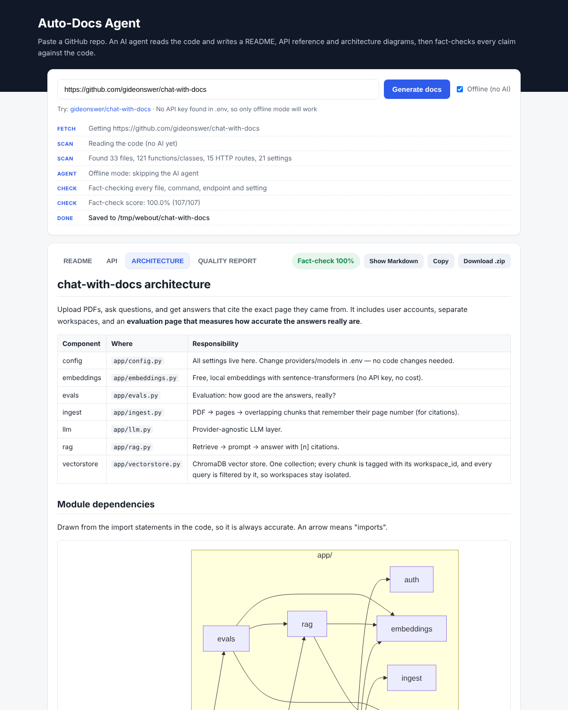
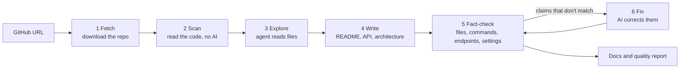

# Auto-Docs Agent

[](https://github.com/gideonswer/auto-docs-agent/actions/workflows/tests.yml)

Point it at a GitHub repository and it writes a **README**, an **API reference** and **architecture diagrams** in Mermaid. Then it fact-checks every file, command, endpoint and setting it mentions against the actual code, and fixes the claims that don't match.

```bash
python -m autodocs https://github.com/gideonswer/chat-with-docs
```



*The web page after an offline run (no AI) on [Chat with Docs](https://github.com/gideonswer/chat-with-docs).*

## Why this exists

AI-written documentation usually reads well and is wrong in small ways: a file that was renamed, a command nobody defined, an endpoint with the wrong path. Readers copy those lines, they fail, and they stop trusting the docs.

Auto-Docs Agent splits the work so that can't happen silently:

| Part of the docs | Who writes it | Why |
|---|---|---|
| File tree, settings table, endpoint paths, parameters, request fields, `curl` examples, dependency diagram | **The code itself**, through static analysis | These are facts. Copying them is always right; generating them can only add mistakes. |
| Summaries, explanations, how-it-works steps, component and sequence diagrams | **The AI agent**, after reading the code | These need judgement, which is what a language model is good at. |
| Quality report | **A fact-checker** | Every checkable claim is compared with the repository, and the score is published with the docs. |

## What you get

For each repository, the agent writes five files to `output/<repo-name>/`:

| File | Contents |
|---|---|
| `README.md` | Summary, features, how it works, tech stack, quick start, settings table, API summary, project tree |
| `API.md` | Every HTTP endpoint with login rules, parameters, request fields and validation rules, a `curl` example, responses and errors. Projects without endpoints get a function and class reference instead. |
| `ARCHITECTURE.md` | Component diagram, sequence diagram of the main flow, module dependency diagram, API map, dependencies and design decisions |
| `QUALITY_REPORT.md` | The fact-check score, every claim that couldn't be verified, the model used and the files the agent read |
| `agent_trace.json` | The agent's notes and every tool call it made, for debugging |

See [`examples/chat-with-docs/`](examples/chat-with-docs/) for real output: docs for my [Chat with Docs](https://github.com/gideonswer/chat-with-docs) project, written by Groq's `gpt-oss-20b` and fact-checked at 100% (119 of 119 claims). For comparison, [`examples/chat-with-docs-offline/`](examples/chat-with-docs-offline/) shows offline mode (no AI).

## How it works



1. **Fetch.** Downloads the repo as a zip from GitHub, or clones it with `git` if the download fails. Local folders work too.
2. **Scan.** Reads the code without any AI. Python files are parsed with the `ast` module, and JavaScript and TypeScript files with pattern matching. This step finds HTTP routes (FastAPI, Flask, Express), including router prefixes, which routes need a login, settings from `.env.example` and settings classes, request models, dependencies, entry points and imports.
3. **Explore.** The agent gets a summary of the scan and up to 8 tool calls (`list_dir`, `read_file`, `search`). It decides what to read, then hands over structured notes: purpose, features, components, main data flow and gotchas.
4. **Write.** The AI writes the prose and diagrams. Exact tables from step 2 are inserted through placeholders, so the AI never retypes them. Each Mermaid diagram is cleaned up and checked, sent back to the AI for one repair if it's broken, and dropped if it still won't render. A broken diagram never reaches the docs.
5. **Fact-check.** Every file path, shell command, endpoint, setting name and diagram in the three documents is checked against the repository.
6. **Fix.** Claims that fail go back to the AI with the facts. The corrected README is kept only if its score is the same or higher.

### The agent loop

The agent replies with one JSON action per turn instead of using each provider's native function-calling format:

```json
{"thought": "Find where uploads are processed", "action": "search", "args": {"pattern": "def upload", "glob": "*.py"}}
```

This works the same way on Gemini, Groq, Claude and local models. If Gemini fails halfway through a run, Groq continues the **same conversation**. Native tool-call formats differ between providers and can't be handed over mid-run.

## Quick start

You need Python 3.11 or later and a free [Gemini API key](https://aistudio.google.com/apikey). A free [Groq key](https://console.groq.com/keys) is optional, as a backup.

1. Get the code and install the dependencies:

   ```bash
   git clone https://github.com/gideonswer/auto-docs-agent.git
   cd auto-docs-agent
   python -m venv .venv
   # Windows: .venv\Scripts\activate    macOS/Linux: source .venv/bin/activate
   pip install -r requirements.txt
   ```

2. Create your settings file and paste in your key:

   ```bash
   cp .env.example .env
   ```

   Open `.env` and fill in `GEMINI_API_KEY` (and `GROQ_API_KEY` if you have one). Never commit `.env`.

3. Document a repo from the command line:

   ```bash
   python -m autodocs https://github.com/gideonswer/chat-with-docs
   ```

   Or start the web page and open <http://localhost:8000>:

   ```bash
   uvicorn autodocs.web.app:app --reload
   ```

**No API key yet?** Add `--offline` to the command, or tick **Offline** on the web page. You get docs built from static analysis only: no AI summaries, but every table, diagram and example is still there.

## Command-line options

```text
python -m autodocs <repo> [options]
```

| Option | What it does |
|---|---|
| `<repo>` | A GitHub URL (`https://github.com/owner/repo`), `owner/repo`, a link to a branch or a local folder |
| `-o`, `--out` | Output folder. Default: `output` |
| `--offline` | Skip the AI and use static analysis only |
| `--steps N` | Maximum agent tool calls. Default: 8 |
| `--no-fix` | Report unverified claims but don't ask the AI to correct them |
| `-v` | Show retries and model switches |

## Configuration

All settings live in `.env`. See [`.env.example`](.env.example) for the full list.

| Setting | Default | What it does |
|---|---|---|
| `LLM_PROVIDER` / `LLM_MODEL` | `gemini` / `gemini-3.8-flash` | Main model. Providers: `gemini`, `groq`, `claude`, `openai_compatible` |
| `LLM_FALLBACK_PROVIDER` / `LLM_FALLBACK_MODEL` | `groq` / `openai/gpt-oss-20b` | Backup model, used automatically when the main one fails. Leave blank to turn off. |
| `GEMINI_API_KEY`, `GROQ_API_KEY`, `ANTHROPIC_API_KEY` | none | Keys for each provider. You only need the ones you use. |
| `REASONING_EFFORT` | `low` | How long thinking models think. `low` keeps runs fast and inside free-tier limits. |
| `MAX_AGENT_STEPS` | `8` | Tool calls the agent may make. More steps can give better notes but use more API calls. |
| `GITHUB_TOKEN` | none | Lets you document private repos |
| `MAX_REPO_MB` | `50` | Repos larger than this are refused |
| `GROQ_MAX_INPUT_CHARS` | `20000` | Requests to Groq are shortened to this size, because its free tier allows few tokens per minute |

Model names change. If you get a "model not found" error, check the current names in [Google AI Studio](https://aistudio.google.com) or the [Groq console](https://console.groq.com/docs/models) and update `.env`.

**Switch to Claude:** set `LLM_PROVIDER=claude` and `LLM_MODEL=claude-haiku-5-5`, add `ANTHROPIC_API_KEY`, and run `pip install anthropic`. No code changes are needed.

## What the fact-checker checks

| Claim in the docs | Counts as verified when |
|---|---|
| A file or folder, such as `autodocs/cli.py` | It exists in the repo |
| A command in a code block | The files, modules, npm scripts or Makefile targets it uses exist (`pip install -r`, `python`, `python -m`, `uvicorn`, `npm run`, `cp`, `cd`, `git clone`, `docker`, `make`, `pytest`) |
| An endpoint, such as `POST /api/jobs` | A route with that method and path exists, including router prefixes |
| A setting, such as `GEMINI_API_KEY` | The code reads it, or it's listed in an `.env` example file |
| A Mermaid diagram | It passes the structure checks (and renders, if the [Mermaid CLI](https://github.com/mermaid-js/mermaid-cli) `mmdc` is installed) |

It also warns about marketing words, which the writing prompts forbid.

A high score means the docs don't point to anything that doesn't exist. It doesn't prove every explanation is right, so review the AI-written prose before you publish it.

## Languages and limits

- **Best support:** Python (FastAPI, Flask), and JavaScript or TypeScript with Express.
- **Other languages** (Go, Rust, Java and more) get a file tree, dependencies and AI-written docs, but no route or function extraction.
- **Big repos** work, but the agent reads only what it can in 8 tool calls, so docs for very large projects stay high level.
- **The web page** keeps jobs in memory for one hour and runs two at a time. It's built for local use and demos, not for public hosting.

## Project structure

```text
auto-docs-agent/
├── autodocs/
│   ├── fetch.py            download a repo (zip, then git) or use a local folder
│   ├── scanner.py          walk the repo and build the RepoMap of facts
│   ├── analyze_python.py   functions, classes, routes, settings and imports via ast
│   ├── analyze_js.py       Express routes, exports and imports
│   ├── tools.py            read-only tools the agent can call
│   ├── agent.py            the explore loop
│   ├── llm.py              Gemini, Groq, Claude, Ollama, with retry and fallback
│   ├── writers.py          README, API and architecture writers
│   ├── mermaid.py          diagrams from code, plus cleaning and checking AI diagrams
│   ├── verify.py           fact-checker and quality report
│   ├── pipeline.py         runs all the steps
│   ├── cli.py              command line
│   └── web/                FastAPI app and single-page UI
├── tests/                  47 tests, no API key needed
├── examples/               sample output
├── .env.example
└── requirements.txt
```

## Running the tests

```bash
pytest
```

The tests use a scripted fake model that makes typical mistakes, such as a made-up command, an endpoint that doesn't exist and a Mermaid diagram that won't render. They check that the pipeline catches and fixes each one. One test runs the real OpenAI client against a local fake server, so the exact HTTP requests sent to Gemini and Groq are tested too, including a retry after a `503` error.

On every push, GitHub Actions runs the tests and has the tool document **this repository** in offline mode. The build fails if that scores below 100%.

## Design decisions

- **Facts from code, words from AI.** Anything that can be copied from the code is copied, and the AI writes only what needs judgement. This is the main reason the docs stay accurate.
- **Plain JSON actions instead of native tool calling.** The fallback model can take over a run halfway through.
- **Free-tier friendly.** Retries respect the wait times in rate-limit errors. A daily limit switches straight to the backup model, and requests to Groq are shortened to fit its small limit.
- **Read-only agent.** The agent's tools can't write files, run code or leave the repo folder.
- **Diagrams that render or nothing.** A broken diagram is worse than none, so diagrams that fail the checks are dropped and listed in the report.

## License

MIT. See [`LICENSE`](LICENSE).
