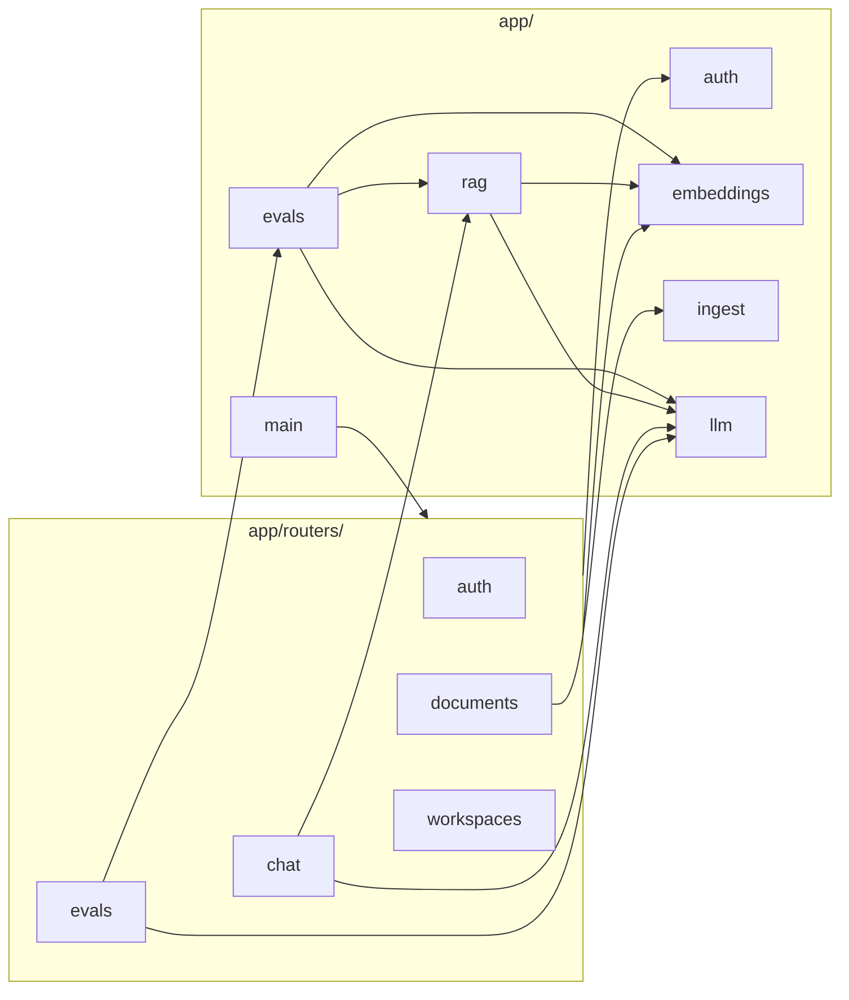
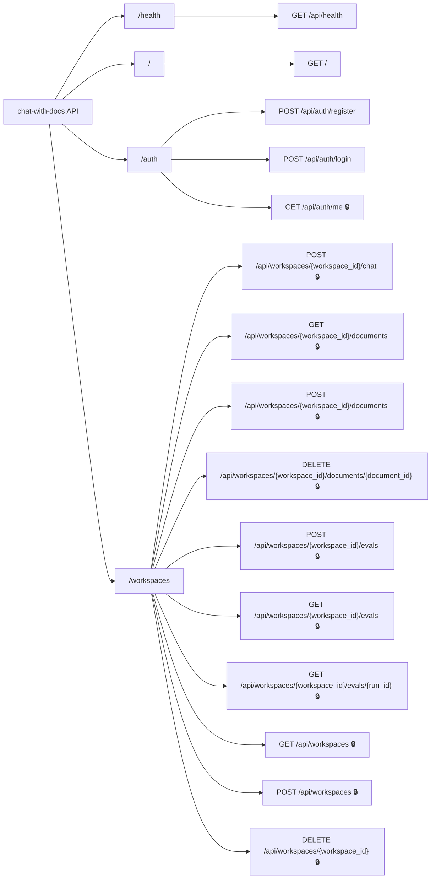

# chat-with-docs architecture

Upload PDFs, ask questions, and get answers that cite the exact page they came from. It includes user accounts, separate workspaces, and an **evaluation page that measures how accurate the answers really are**.

| Component | Where | Responsibility |
|---|---|---|
| config | `app/config.py` | All settings live here. Change providers/models in .env — no code changes needed. |
| embeddings | `app/embeddings.py` | Free, local embeddings with sentence-transformers (no API key, no cost). |
| evals | `app/evals.py` | Evaluation: how good are the answers, really? |
| ingest | `app/ingest.py` | PDF -> pages -> overlapping chunks that remember their page number (for citations). |
| llm | `app/llm.py` | Provider-agnostic LLM layer. |
| rag | `app/rag.py` | Retrieve -> prompt -> answer with [n] citations. |
| vectorstore | `app/vectorstore.py` | ChromaDB vector store. One collection; every chunk is tagged with its workspace_id, and every query is filtered by it, so workspaces stay isolated. |

## Module dependencies

Drawn from the import statements in the code, so it is always accurate. An arrow means "imports".

Left out to keep the picture readable, because most modules use them: `app.config`, `app.db`, `app.models`, `app.schemas`, `app.vectorstore`.

## HTTP API map

🔒 = login needed. Details are in [API.md](API.md).

## Dependencies

- **Python:** `fastapi`, `uvicorn`, `sqlalchemy`, `pydantic-settings`, `email-validator`, `python-multipart`, `pyjwt`, `bcrypt`, `pypdf`, `chromadb`, `sentence-transformers`, `openai`, `anthropic`, `pytest`, `httpx`, `reportlab`

---
*Generated by [Auto-Docs Agent](https://github.com/gideonswer/auto-docs-agent). The dependency diagram and API map come straight from the code; the other diagrams are AI-drawn and checked to render.*
