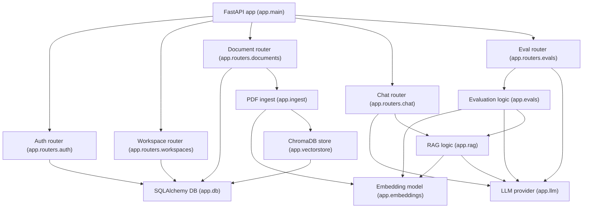
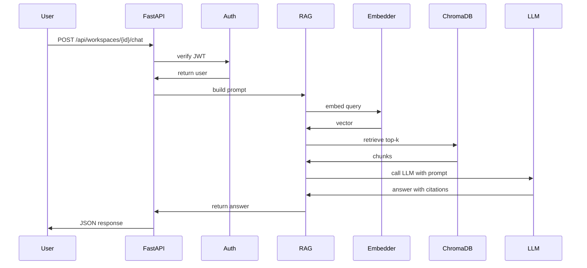
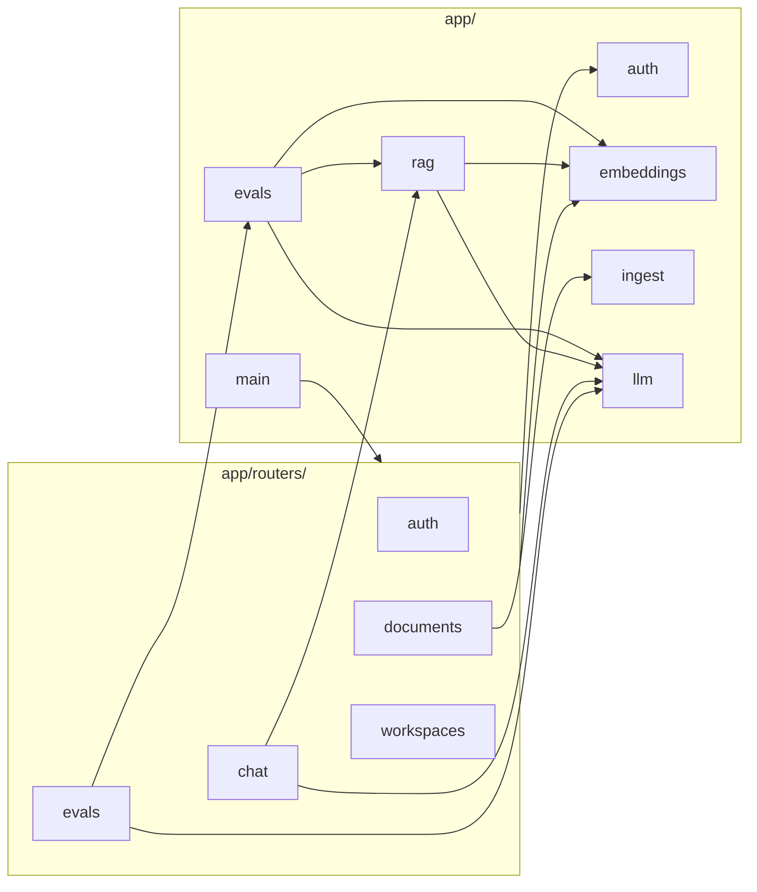
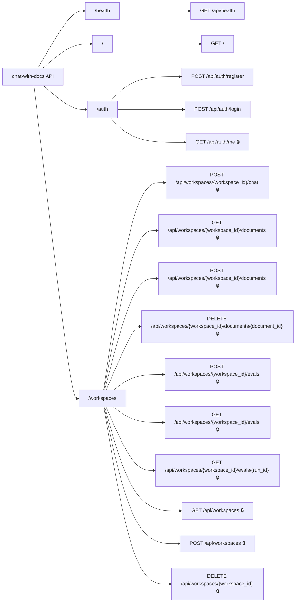

# chat-with-docs architecture

The repository implements a FastAPI web service that lets users upload PDFs, ask questions, and get answers with page‑level citations. It stores user data in SQLite, chunks PDFs into overlapping pieces, embeds them with sentence‑transformers, and keeps the vectors in a local ChromaDB collection.

When a user asks a question, the service embeds the query, retrieves the top‑k relevant chunks from the workspace‑filtered vector store, builds a prompt that includes citation markers, calls the configured LLM, and returns the answer with citations. Evaluation runs compare the LLM answer to a reference answer and report metrics.

## Components

| Component | Where | Responsibility |
|---|---|---|
| app.main | `app/main.py` | FastAPI app setup, router inclusion, health endpoint, static file serving |
| app.config | `app/config.py` | Central settings holder using pydantic‑settings |
| app.db | `app/db.py` | SQLAlchemy engine and session factory |
| app.models | `app/models.py` | ORM models for users, workspaces, documents, eval runs, and chunks |
| app.embeddings | `app/embeddings.py` | Sentence‑transformer based embedder |
| app.vectorstore | `app/vectorstore.py` | ChromaDB wrapper for storing and querying chunks |
| app.rag | `app/rag.py` | Prompt construction, citation parsing, and answer generation |
| app.llm | `app/llm.py` | Provider‑agnostic LLM interface and fallback logic |
| app.ingest | `app/ingest.py` | PDF parsing, page extraction, cleaning, chunking |
| app.evals | `app/evals.py` | Evaluation logic: scoring, judging, summarizing results |

## Chat request flow

## Module dependencies

Drawn from the import statements in the code, so it is always accurate. An arrow means "imports".

Left out to keep the picture readable, because most modules use them: `app.config`, `app.db`, `app.models`, `app.schemas`, `app.vectorstore`.

## HTTP API map

🔒 = login needed. Details are in [API.md](API.md).

## Dependencies

- **Python:** `fastapi`, `uvicorn`, `sqlalchemy`, `pydantic-settings`, `email-validator`, `python-multipart`, `pyjwt`, `bcrypt`, `pypdf`, `chromadb`, `sentence-transformers`, `openai`, `anthropic`, `pytest`, `httpx`, `reportlab`

## Design decisions

- Using a single ChromaDB collection with a workspace_id tag keeps workspaces isolated without needing separate databases.
- Embedding with sentence‑transformers avoids external API calls and keeps the system free to run offline.
- The LLM layer is provider‑agnostic; it falls back to a secondary provider automatically, improving reliability.
- JWT authentication is handled in a dedicated router, ensuring all workspace routes enforce ownership checks.
- PDF ingestion splits pages into overlapping chunks; this improves retrieval quality by preserving context across chunk boundaries.

---
*Generated by [Auto-Docs Agent](https://github.com/gideonswer/auto-docs-agent). The dependency diagram and API map come straight from the code; the other diagrams are AI-drawn and checked to render.*
